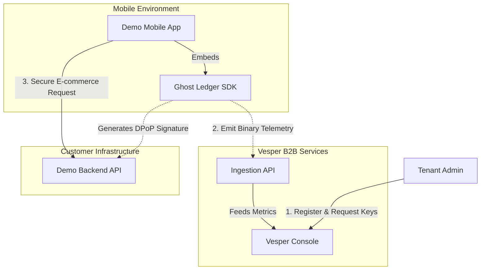
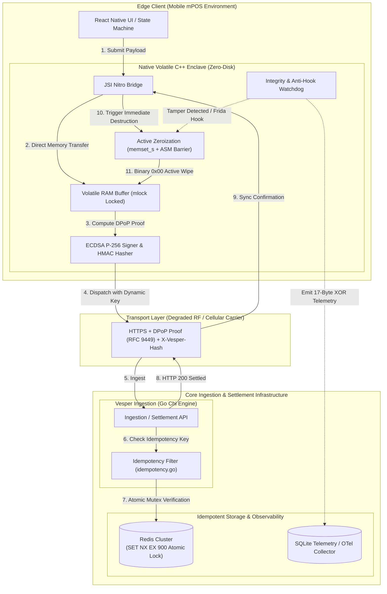

# V.E.S.P.E.R. Core Platform

[](https://vesper-console.netlify.app/)
[](https://vesper-ingestion.onrender.com/)
[](https://demo-backend-4puz.onrender.com/)
[](https://appetize.io/app/b_zgnm35x6kvriaoad7ytvw4oamu)
[](https://github.com/ChristianPastenC/vesper-platform/releases/tag/latest-demo)
[](https://www.npmjs.com/package/@vesper-core/ghost-ledger)

This repository contains the **V.E.S.P.E.R. (Volatile Enclave for Secure Payload Encryption & Routing)** Developer Platform. It is a comprehensive B2B SaaS system and Zero-Trust cryptographic ecosystem providing core telemetry ingestion APIs, a management portal, a native C++ security SDK, and complete sample reference applications (mobile and backend) demonstrating how to implement a Zero-Trust architecture.

## Live Environments

You can explore the deployed platform and API implementations via the following public URLs:

| Service | Live URL | Hosting |
| :--- | :--- | :--- |
| **Vesper Console (Frontend)** | [vesper-console.netlify.app](https://vesper-console.netlify.app/) | Netlify |
| **Vesper Ingestion (API)** | [vesper-ingestion.onrender.com](https://vesper-ingestion.onrender.com/) | Render |
| **Demo Backend (E-commerce)**| [demo-backend-4puz.onrender.com](https://demo-backend-4puz.onrender.com/) | Render |
| **Demo Mobile (Browser Emulator)** | [appetize.io/app/b_zgnm35x6kvriaoad7ytvw4oamu](https://appetize.io/app/b_zgnm35x6kvriaoad7ytvw4oamu) | Appetize.io (Android) |
| **Demo Mobile (Rolling APK)** | [GitHub Release (`latest-demo`)](https://github.com/ChristianPastenC/vesper-platform/releases/tag/latest-demo) | GitHub Releases |

---

## Executive Summary: The Mobile Resilience Dilemma

In mobile payment acquiring (mPOS) and financial applications across Latin America, operational deployments encounter severe cellular and radio-frequency degradation (last-mile logistics, transit tunnels, saturated venues). Engineering teams face a false architectural dichotomy:

1. **The Fail-Closed Paradigm:** Abortively terminating in-flight operations upon any transport socket failure. Empirical diagnostic data ($N = 24$) demonstrates an unacceptable **18.4% to 23.8% transaction abandonment rate**, inflicting millions in lost gross merchandise value and direct merchant churn.
2. **The Secondary Flash Fallback (Store-and-Forward):** Caching unsubmitted transaction objects and cardholder payloads onto non-volatile flash storage (`AsyncStorage`, SQLite, Realm). Due to the hardware physics of NAND Flash Translation Layers (FTL)—characterized by out-of-place writes and wear-leveling algorithms—executing file deletion (`unlink` or SQL `DELETE`) leaves plaintext Primary Account Numbers (PAN) and Sensitive Authentication Data (SAD) un-erased on physical silicon blocks. This constitutes an immediate violation of **PCI-DSS v4.0 Requirement 3.2** and **CNBV Circular Única de Bancos**.

**V.E.S.P.E.R.** resolves this dilemma through a **Zero-Disk Volatile Memory Architecture**, sequestering in-flight payloads inside native C++ physical RAM boundaries with active compiler-safe zeroization, guaranteeing business continuity without non-volatile forensic remanence.

## Formal Business Impact Analysis (BIA) Metrics

| Metric | Target Value | Verification Boundary | Operational Justification |
| :--- | :---: | :--- | :--- |
| **MTPD** (Max Tolerable Period of Disruption) | **15 min** (900 s) | Client Queue TTL & Ingestion Pipeline | Calibrated against cellular outage telemetry ($P_{99} \le 13\text{ min}$). Exceeding 900 s triggers active zeroization to prevent indefinite memory retention. |
| **RPO** (Recovery Point Objective) | **0 s** | C++ Volatile RAM Enclave (`ghost-ledger`) | In-flight payload captured atomically into volatile RAM before socket collapse; zero data loss during network drop. |
| **RTO** (Recovery Time Objective) | **< 100 ms** | React Native JSI Native Boundary | Nitro Modules zero-copy direct memory binding intercepts socket errors and enqueues payload instantaneously. |
| **Cryptographic Latency** | **< 15 ms** | Native ECDSA P-256 (DPoP) & HMAC-SHA256 | Native C++ cryptographic signing meets strict real-time checkout constraints without degrading UI frame rates. |

---

## Why V.E.S.P.E.R.? (The Zero-Trust Philosophy)

Modern mobile applications are inherently vulnerable. Attackers can reverse-engineer standard APIs, extract static JWT Bearer tokens to perform replay attacks, or use dynamic instrumentation tools (like Frida) to manipulate memory and bypass security checks at runtime. 

The **V.E.S.P.E.R.** architecture solves this by applying strict **Zero-Trust** principles through multiple defense layers:

1. **Volatile Enclave (Memory Isolation):** Sensitive cryptographic operations do not happen in the vulnerable JavaScript runtime. They are executed directly in a native C++ Volatile RAM Ledger that actively detects memory tampering and triggers an `IntegrityBreachError` if hooked.
2. **Secure Payload Encryption (DPoP & HMAC):** Instead of relying solely on a static Bearer token, the mobile client uses an ephemeral ECDSA key pair to dynamically sign *every single HTTP request*. Request bodies are also cryptographically hashed via HMAC-SHA256. A stolen token is useless without the private key, and payloads cannot be altered in transit (MitM).
3. **Routing & Active Telemetry:** When tampering is detected locally on the device, the C++ SDK bypasses standard HTTP layers to emit a 17-byte XOR-encrypted binary payload. This gets routed directly to the Vesper Ingestion API, alerting administrators in real-time.

---

## Ecosystem Architecture

To implement this philosophy, the project is structured as a monorepo containing the core platform, the security library, and the integration examples:

1. **[`vesper-ingestion`](./apps/vesper-ingestion)** (Backend - Go)
   - A high-performance Go HTTP server using `go-chi`.
   - Exposes REST endpoints for B2B SaaS authentication and API Key generation.
   - Exposes a binary ingestion endpoint (`/api/v1/support/telemetry`) that receives raw, XOR-encrypted telemetry data from client SDKs.
   - Forwards telemetry to OpenTelemetry collectors and stores a local copy in SQLite.

2. **[`vesper-console`](./apps/vesper-console)** (Frontend - Astro)
   - A lightweight, fast frontend built in Astro and hydrated with React ("Islands Architecture").
   - Allows organizations to manage their tenant profiles and generate `X-Vesper-API-Key` strings for their mobile apps.
   - Features a real-time dashboard using **Recharts** that visualizes incoming telemetry metrics.

3. **[`@vesper-core/ghost-ledger`](./packages/ghost-ledger)** (SDK - C++/TypeScript)
   - The native cryptographic engine that integrates securely into client mobile applications.
   - Calculates dynamic DPoP signatures and detects memory tampering via its C++ Volatile RAM Ledger.

4. **[`demo-backend`](./examples/demo-backend)** (Backend - Go)
   - A sample reference implementation of an E-commerce API built with Clean Architecture.
   - Acts as the verifier. It strictly validates the ECDSA DPoP signatures and HMAC payloads generated by the mobile SDK before fulfilling business logic (like checkouts).

5. **[`demo-mobile`](./examples/demo-mobile)** (Mobile - React Native)
   - A sample mobile e-commerce application demonstrating the proper integration of the `@vesper-core/ghost-ledger` library.

### Full System Workflow



### State Segregation Architecture



---

## Regulatory Compliance Crosswalk

| Regulatory Framework | Mandatory Clause / Article | Platform Implementation | Monorepo Verification Component |
| :--- | :--- | :--- | :--- |
| **PCI-DSS v4.0** | **Req. 3.2 & 3.4:** Prohibition of SAD storage and protection of PAN data post-authorization. | Zero-Disk policy; absolute prohibition of SQLite/AsyncStorage storage; RAM locking via `mlock(2)`. | `packages/ghost-ledger/cpp/VolatileQueue.hpp`<br>`docs/compliance/secure_memory_policy.md` |
| **DORA (EU 2022/2554)** | **Arts. 6 al 12:** ICT Risk Management, Business Continuity, and Backup/Restore. | Transient RAM queueing bridging network drops ($RTO < 100\text{ ms}$, $MTPD = 900\text{ s}$) with deterministic TTL zeroization. | `docs/compliance/dora_operational_resilience.md`<br>`docs/business_context_bia.md` |
| **DORA (EU 2022/2554)** | **Art. 26:** Threat-Led Penetration Testing (TLPT). | Automated headless Android emulator with Frida dynamic hook injection in CI/CD pipeline. | `.github/workflows/demo-mobile-ci.yml`<br>`examples/demo-mobile/scripts/frida_dast_test.py` |
| **CNBV (CUB)** | **Art. 163 bis & Anexo 52:** Integridad, confidencialidad y no repudio en terminales móviles de pago. | Firma asimétrica DPoP por petición (RFC 9449), hash HMAC-SHA256 y deduplicación atómica contra doble cobro. | `examples/demo-backend/internal/handler/middleware/dpop_auth.go`<br>`examples/demo-backend/internal/adapter/db/redis_idempotency.go` |
| **ISO 22301:2019** | **Cl. 8.2.2 & Cl. 8.4:** Análisis de Impacto en el Negocio (BIA) y Procedimientos de Continuidad. | Definición cuantitativa de criticidad por niveles (Tiers 1, 2, 3), RPO = 0s, RTO < 100ms y runbook formal BCP/DRP. | `docs/business_context_bia.md`<br>`docs/operational_resilience/bcp_drp_runbook.md` |

---

## Getting Started

### Unified Developer Lifecycle (`Makefile`)

The repository includes a native `Makefile` to orchestrate services, run cross-workspace tests, and verify ports without container daemons or external database clusters. This preserves the lightweight, embedded-first architecture documented in [Secure Memory Policy (`docs/compliance/secure_memory_policy.md`)](./docs/compliance/secure_memory_policy.md) and aligns with the recovery tiering defined in [Business Impact Analysis (`docs/business_context_bia.md`)](./docs/business_context_bia.md#3-tiering-hierarchy--recovery-metrics):

| Service | Command | Port | Persistence Engine | BIA Tier | Target Recovery |
| :--- | :--- | :--- | :--- | :--- | :--- |
| **Demo Backend Verifier** | `make dev-backend` | `8080` | Embedded BoltDB (`vesper.db`) | **Tier 1** | RTO $\le 15$ min, RPO $= 0$ |
| **Vesper Ingestion API** | `make dev-ingestion` | `8081` | Embedded SQLite (`telemetry.db`) | **Tier 2** | RTO $\le 30$ min, RPO $\le 5$ min |
| **Vesper Console Portal** | `make dev-console` | `4000` | Astro SSG / React Client | **Tier 3** | RTO $\le 4$ h, RPO $\le 1$ h |

#### Common Developer Commands:
```bash
# 1. Diagnose local toolchains (Go 1.22+, Node 18+) and port availability
make verify-env

# 2. Run unit and integration tests across all microservices
make test

# 3. Perform static analysis across Go and Astro workspaces
make lint

# 4. Reset local embedded telemetry database (re-seeds default tenant)
make clean-db
```

### Manual Individual Service Execution

If you prefer executing services manually in separate terminals:

#### 1. Run the Telemetry API Backend
```bash
cd apps/vesper-ingestion
go mod download
go run ./cmd/server
```
*The server will run on `http://127.0.0.1:8081`.*
*SQLite database `telemetry.db` will be automatically generated and seeded.*

#### 2. Run the B2B Portal
```bash
cd apps/vesper-console
npm install
npm run dev
```
*The portal will run on `http://localhost:4000` (port fixed in `package.json`, not Astro's default 4321).*

#### 3. Database Management
To clear the SQLite database in `vesper-ingestion` and start fresh:
```bash
cd apps/vesper-ingestion
go run ./cmd/cli clean-db
```

### Consolidated Environment Variables (`.env`)

| Variable | Target Service | Required | Default | Purpose |
| :--- | :--- | :---: | :--- | :--- |
| `PORT` | `vesper-ingestion` / `demo-backend` | No | `8081` / `8080` | HTTP listening port. |
| `DB_PATH` | `vesper-ingestion` | No | `./telemetry.db` | Path to embedded SQLite telemetry database. |
| `JWT_SECRET` | `vesper-ingestion` | Yes | - | High-entropy secret key for B2B portal authentication JWTs. |
| `PAYLOAD_SECRET_KEY` | `demo-backend` | Yes | - | 32-byte secret for validating incoming `X-Vesper-Hash` payloads. |
| `REDIS_URL` | `demo-backend` | No | `localhost:6379` | Distributed Redis instance for cluster-wide idempotency mutexes. |
| `DEV_DPOP_BYPASS` | `demo-backend` | No | `false` | Set to `true` strictly in local debugging to bypass DPoP signature verification. |
| `PUBLIC_API_URL` | `vesper-console` | No | `http://127.0.0.1:8081` | Ingestion backend endpoint for Astro/React frontend components. |

### Native C++ Core Cross-Compilation (`ghost-ledger`)

#### Desktop Testing (Linux / macOS / Windows)
```bash
cd packages/ghost-ledger
# Configure and build native C++ tests
cmake -S . -B build -DBUILD_TESTING=ON
cmake --build build --config Release
# Run cryptographic test suite with memory zeroization assertions
cd build && ctest -V
```

#### Android Cross-Compilation (NDK)
The Android binary is compiled via Gradle through the React Native Nitro Modules toolchain:
```bash
cd examples/demo-mobile/android
# Cross-compiles for armeabi-v7a, arm64-v8a, x86, x86_64
./gradlew assembleRelease \
  -Dorg.gradle.jvmargs="-Xmx4096m" \
  -DANDROID_NDK_VERSION="26.1.10909125"
```

#### iOS Native Enclave Compilation (Xcode)
```bash
cd examples/demo-mobile/ios
pod install
xcodebuild -workspace VesperCore.xcworkspace \
  -scheme demo-mobile \
  -configuration Release \
  -destination 'generic/platform=iOS' \
  CODE_SIGNING_ALLOWED=NO
```


---

## API Testing with Bruno

This repository includes a native [Bruno](https://www.usebruno.com/) collection for API testing:
> [!TIP]
> Ensure you select the `Local` environment in Bruno so the `{{base_url}}` points to `http://127.0.0.1:8081` (Ingestion) or `http://127.0.0.1:8080` (Demo Backend).

- **`bruno/demo-backend/`**: Contains the E-Commerce backend endpoints. **Note:** Most endpoints will fail without the Development Bypasses enabled due to strict DPoP validations.
- **`bruno/vesper-ingestion/`**: Contains the B2B Auth and Ingestion endpoints.

### Ingestion Endpoints Overview

| Method | Endpoint | Description |
| :--- | :--- | :--- |
| `POST` | `/api/v1/b2b/signup` | Register new tenant |
| `POST` | `/api/v1/b2b/login` | Authenticate |
| `POST` | `/api/v1/b2b/keys` | Generate SDK key |
| `GET` | `/api/v1/b2b/keys` | List keys |
| `DELETE` | `/api/v1/b2b/keys` | Delete an SDK key |
| `GET` | `/api/v1/b2b/metrics` | Real-time data for the chart |
| `GET` | `/api/v1/support/ping` | Health check |
| `POST` | `/api/v1/support/telemetry` | SDK Binary ingestion |

---

## Continuous Integration & Security Pipelines

This repository enforces strict CI/CD and security testing via GitHub Actions:

<details>
<summary><strong>View Pipeline Workflows</strong></summary>

### 1. Vesper Ghost Ledger CI (`ghost-ledger-ci.yml`)
Ensures the structural integrity of the native cryptographic library:
- **`cpp-tests`**: Uses CMake to build and run the pure C++ core tests natively on Ubuntu.
- **`js-lint-test`**: Validates the TypeScript specs and runs pure JS fallback engine unit tests.

### 2. Demo Mobile App CI (`demo-mobile-ci.yml`)
Tests the mobile application and runs live anti-tampering validation:
- **`lint-and-test`**: Lints and tests the React Native codebase.
- **`build-android` & `build-ios`**: Assembles the Android APK (Gradle) and iOS Simulator build (Xcodebuild).
- **`security-dast` (Anti-Tampering Cross-Test)**: Boots a headless Android emulator with KVM acceleration. It then injects **Frida** into the compiled APK to simulate a real-world memory tampering attack. This guarantees the `IntegrityBreachError` mechanism functions flawlessly against dynamic runtime hooks. It posts the security report directly to Pull Requests.

### 3. Vesper Ingestion API CI (`vesper-ingestion-ci.yml`)
Enforces quality gates and strict build parity with Render:
- **`lint-and-vet`**: Performs static analysis (`go vet ./...`) and ensures code cleanliness.
- **`test-and-coverage`**: Runs unit test suite with Go concurrency race detector (`-race`) and publishes coverage metrics to `$GITHUB_STEP_SUMMARY`.
- **`build-validation`**: Verifies binary compilation with production flags (`-ldflags="-w -s"`).

### 4. Vesper Console CI (`vesper-console-ci.yml`)
Guarantees frontend integrity and build parity with Netlify:
- **`verify-and-build`**: Runs Vitest test suites, checks Astro template type diagnostics (`npx astro check`), and builds production SSG distribution assets (`dist/`).

### 5. Multi-Engine DevSecOps Scan (`security-scan.yml`)
Continuous automated threat mitigation aligned with NIST CSF 2.0 (`DE.CM`) and DORA Art. 13:
- **`gitleaks-scan`**: Scans git commit history against `.gitleaks.toml` rules to block secret leaks.
- **`trufflehog-scan`**: Deep entropy and verified credential detection across git branches.
- **`dependency-vulnerabilities`**: Executes `govulncheck` on Go services and `npm audit --omit=dev --audit-level=high` on frontend packages.
- **`security-summary`**: Renders unified security compliance matrix directly in Pull Requests and CI step summaries.

</details>

---

## Security, Compliance & Operational Resilience Documentation

Comprehensive technical specifications, threat models, and operational resilience frameworks are documented in the [`docs/`](./docs) directory:

| Document | Primary Focus | Regulatory / Industry Standard |
| :--- | :--- | :--- |
| [**Architecture Decision Records (ADRs)**](./docs/adr/ADR-001-zero-disk-architecture.md) | Canonical decision log: Zero-Disk architecture ([ADR-001](./docs/adr/ADR-001-zero-disk-architecture.md)), Active Zeroization ([ADR-002](./docs/adr/ADR-002-active-zeroization-compiler-barriers.md)), and Fail-Safe model ([ADR-003](./docs/adr/ADR-003-fail-safe-state-model.md)). | PCI-DSS, DSE Neutralization, LMK |
| [**Unified Regulatory Compliance Matrix**](./docs/compliance/unified_regulatory_compliance_matrix.md) | Crosswalk mapping platform controls to PCI-DSS v4.0, DORA (EU 2022/2554), CNBV (CUB), and ISO 22301:2019. | PCI-DSS v4.0, DORA, CNBV, ISO 22301 |
| [**Threat Modeling Specification**](./docs/security/threat_model.md) | Perimeter specifications, 3 Trust Boundaries (JSI, Network, Bus), STRIDE mitigations, and Out-of-Scope boundaries. | STRIDE, Threat Modeling |
| [**Business Impact Analysis (BIA)**](./docs/business_context_bia.md) | Quantitative recovery metrics ($RTO < 100\text{ms}$, $RPO = 0\text{s}$, MTPD), tiering hierarchy, and BCP execution sequence. | ISO 22301:2019 Cl. 8.2.2, DORA Art. 11 |
| [**DORA Operational Resilience**](./docs/compliance/dora_operational_resilience.md) | ICT risk management, zero-disk volatile memory policy, and Threat-Led Penetration Testing (TLPT) automation via Frida. | Regulation (EU) 2022/2554 |
| [**NIST CSF 2.0 Gap Analysis**](./docs/compliance/gap_analysis_nist_csf.md) | Assessment across Govern, Identify, Protect, Detect, Respond, Recover; prioritized engineering roadmap to Tier 4. | NIST CSF 2.0 |
| [**BCP & DRP Operational Runbook**](./docs/operational_resilience/bcp_drp_runbook.md) | Standard Operating Procedures for edge sequestration, telemetry triage, backend reconciliation, and kill-switch revocation. | ISO 22301 Cl. 8.4, SRE SOP |
| [**Incident Communication Strategy**](./docs/operational_resilience/communication_strategy.md) | Mandatory DORA-aligned escalation protocols, RACI matrices, and merchant-facing templates for critical offline events. | DORA Art. 19 |
| [**Cryptographic Specification**](./docs/compliance/cryptographic_spec.md) | Mathematical specifications for DPoP (RFC 9449), HMAC-SHA256, and SHA-256 block hash chaining. | FIPS 180-4, RFC 9449 |
| [**Secure Memory Policy**](./docs/compliance/secure_memory_policy.md) | Compiler Dead Store Elimination (DSE) barriers, deterministic TTL zeroization, and zero-disk policy. | PCI-DSS v4.0 Req 3.2, GDPR Art. 32 |
| [**NAND Wear Leveling Rationale**](./docs/compliance/nand_wear_leveling_rationale.md) | Physical Flash Translation Layer (FTL) mechanics and forensic justification for zero-disk memory architecture. | PCI-DSS v4.0 Req 3.2, NIST SP 800-88 |
| [**Postgraduate Architecture Audit**](./docs/compliance/postgraduate_architecture_audit.md) | Technical gap evaluation across C++20 core, mobile enclaves, and Go idempotency against postgraduate deliverables. | Master Thesis Audit |
| [**STRIDE Threat Model**](./docs/compliance/stride_threat_model.md) | Endpoint and transport threat enumeration, attack surface mitigations, and fail-secure countermeasures. | Microsoft STRIDE Framework |
| [**Problem Diagnosis & Empirical Findings**](./docs/research/problem_statement_diagnosis.md) | Empirical investigation ($N=24$), Ishikawa causal diagram, MTPD window calibration, and financial impact. | CNBV, Ley Fintech, PCI-DSS v4.0 |
| [**Theoretical Foundations**](./docs/research/theoretical_foundations.md) | Contextual, referential, conceptual, and legal pillars governing low-level cryptography and zeroization runtimes. | NIST SP 800-88, DORA, RFC 9449 |
| [**State of the Art & Research**](./docs/research/state_of_the_art.md) | Scientific foundations on compiler DSE neutralization, TEE vs. JSI boundary latency, and cellular hash-chaining. | IEEE / ACM / USENIX Literature |
| [**Industry Solutions Benchmark**](./docs/research/benchmarking_solutions.md) | Comparative architectural and security benchmark of Square, Clover, Stripe Terminal, mobile offline engines, and RASP systems. | PCI-DSS v4.0 Req 3, EMVCo, ISO/IEC 7816 |

---

## License

This project is licensed under the terms of the [MIT License](./LICENSE). Open source and free for institutional and academic evaluation.
