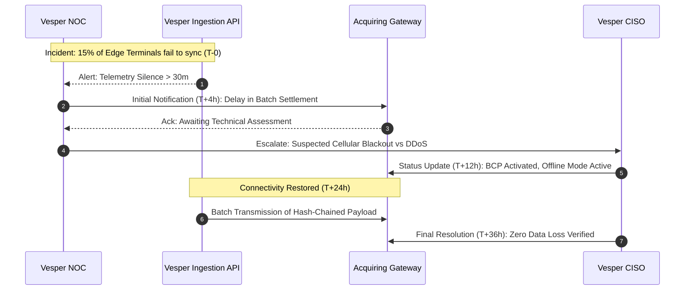

# Operational Resilience: Incident Communication Strategy & Escalation Protocols

## Standard Operating Procedure (U6 A2)
**Author:** Vesper SecOps & Incident Response Team  
**Status:** Active  
**Classification:** DevSecOps / Operational Resilience  
**Cross-References:** [BCP & DRP Runbook (docs/operational_resilience/bcp_drp_runbook.md)](./bcp_drp_runbook.md) | [Business Impact Analysis (docs/business_context_bia.md)](../business_context_bia.md) | [DORA Compliance (docs/compliance/dora_operational_resilience.md)](../compliance/dora_operational_resilience.md)

---

## 1. Executive Summary & Regulatory Mandates

### 1.1. Purpose and Scope
This communication strategy defines the mandatory notification, escalation, and resolution protocols for operational incidents affecting the Vesper Edge Platform. It ensures that communication during critical network partitions, cryptographic tampering events, and service degradations remains structured, auditable, and aligned with international financial resilience mandates.

### 1.2. Regulatory Alignment (DORA Art. 19 & ISO 22301)
As an ICT third-party service provider (CTPP) serving the financial sector, Vesper strictly adheres to the notification timelines mandated by the **Digital Operational Resilience Act (DORA)** and **ISO 22301:2019 (Cl. 8.4)**:
- **T+0 (Immediate Detection):** Automated telemetry identifies the breach or partition via `ghost-ledger` heuristics.
- **T+4 Hours (Initial Notification):** Mandatory disclosure to primary Acquiring Partners and impacted Merchants regarding major ICT-related incidents.
- **T+24 Hours (Intermediate Update):** Status report on remediation efforts, BCP activation, and estimated time to restoration (ETR).
- **T+72 Hours (Final Post-Mortem):** Submission of the technical RCA (Root Cause Analysis) and cryptographic reconciliation audit.

---

## 2. Institutional RACI Matrix for Incident Communication

The following RACI (Responsible, Accountable, Consulted, Informed) matrix designates the chain of command during an operational or security incident:

| Role / Entity | Network Partition (Offline Mode) | Hardware Tampering (Frida/Root) | Acquirer Sync Failure | Ledger Hash Mismatch ($H_n$) |
| :--- | :---: | :---: | :---: | :---: |
| **L1 Support (NOC)** | Responsible | Informed | Responsible | Informed |
| **L3 SecOps Core** | Informed | Responsible | Consulted | Responsible |
| **Platform Architect** | Consulted | Accountable | Accountable | Accountable |
| **Acquiring Bank** | Informed | Informed | Informed | Consulted |
| **Impacted Merchant** | Informed | Informed | Informed | Informed |
| **Regulator (e.g., CNBV/FCA)** | - | - | - | Informed (if > $50k) |

**Definitions:**
- **Responsible:** Executes the communication and runs the operational runbook.
- **Accountable:** Owns the final decision (e.g., triggering a global kill-switch or revoking DPoP keys).
- **Consulted:** Provides technical or legal guidance prior to public statements.
- **Informed:** Receives standard template notifications and ETA updates.

---

## 3. Acquirer & Payment Gateway Notification Protocol

When Vesper Edge nodes fail to synchronize their cryptographic ledger (`ghost-ledger`) with the cloud backend within the strict RPO threshold defined in the [BIA](../business_context_bia.md), the Acquirer communication protocol is activated.

### 3.1. Escalation Timeline

### 3.2. Secure Communication Channels
All communication with acquiring banks containing sensitive diagnostic data MUST occur over mutually authenticated, encrypted channels:
- **Primary:** Dedicated B2B Slack Connect / Microsoft Teams shared channels (End-to-End Encrypted).
- **Secondary:** PGP-encrypted email to designated Acquirer Incident Response aliases.
- **Urgent / Out-of-Band:** Direct mobile contact to Acquirer L3 Duty Managers via encrypted VoIP (Signal / WhatsApp Business).
