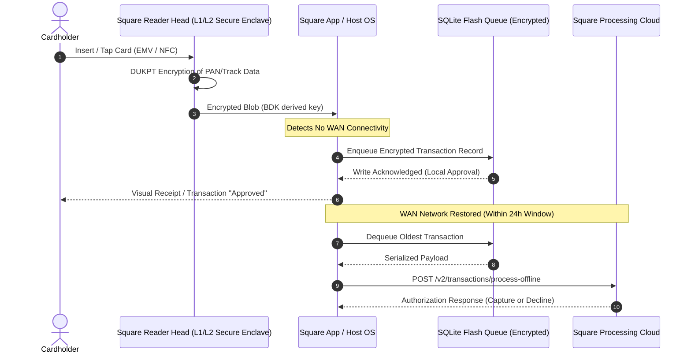
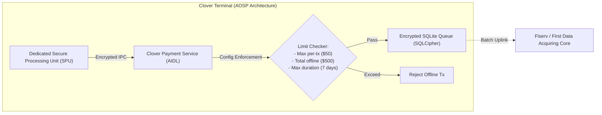

# Industry Solutions Benchmarking: Architectural, Cryptographic, and Operational Analysis of Offline-First & Payment Platforms

## Technical Research Memorandum (U6 A3)
**Author:** Vesper Platform Architecture & Security Research Group  
**Status:** Canonical Industry Benchmark  
**Classification:** DevSecOps / FinTech Systems Engineering  
**Cross-References:** [State of the Art & Research (docs/research/state_of_the_art.md)](./state_of_the_art.md) | [Business Impact Analysis (docs/business_context_bia.md)](../business_context_bia.md) | [DORA Compliance (docs/compliance/dora_operational_resilience.md)](../compliance/dora_operational_resilience.md) | [NIST CSF Alignment (docs/compliance/gap_analysis_nist_csf.md)](../compliance/gap_analysis_nist_csf.md) | [STRIDE Threat Model (docs/compliance/stride_threat_model.md)](../compliance/stride_threat_model.md) | [Secure Memory Policy (docs/compliance/secure_memory_policy.md)](../compliance/secure_memory_policy.md)

---

## 1. Executive Overview & Taxonomy of Offline Transaction Paradigms

### 1.1. Operational Context & The Zero-Connectivity Dilemma
Modern point-of-sale (POS) and mobile point-of-sale (mPOS) terminals operate in hostile, intermittent cellular environments (e.g., in-flight retail, maritime vessels, rural pop-up markets, metropolitan transit networks, and disaster recovery zones). In these environments, uninterrupted IP connectivity to payment gateways cannot be guaranteed.

When network connectivity severs, payment platforms are confronted with the fundamental CAP theorem trade-off: either reject all incoming client transactions (sacrificing business availability and incurring severe merchant revenue losses as documented in [Business Impact Analysis (docs/business_context_bia.md)](../business_context_bia.md#2-financial--operational-impact-quantification)), or permit un-adjudicated offline captures (exposing the acquiring bank and merchant to double-spending, replay attacks, card cloning, and uncollectible debts).

### 1.2. Taxonomy of Offline Processing Paradigms
To evaluate the state of industry solutions, we classify edge architectures into three primary paradigms:

```mermaid
flowchart TD
    subgraph P1["Paradigm 1: Store-and-Forward (SaF)"]
        SaF_Reader["Hardware Card Reader (PIN Pad)"] -->|Encrypted ISO 8583 Payload| SaF_Queue["Non-Volatile Disk Queue (Flash)"]
        SaF_Queue -.->|Asynchronous Uplink| SaF_Acquirer["Acquiring Gateway"]
    end

    subgraph P2["Paradigm 2: Server-Driven Intent (Strict Online)"]
        SD_Client["Client App / POS UI"] -->|Create Intent / RPC| SD_Cloud["Cloud Orchestrator (Stripe)"]
        SD_Cloud -->|Dispatch State Machine| SD_Reader["Hardware Terminal (BBPOS/S700)"]
    end

    subgraph P3["Paradigm 3: Ephemeral Cryptographic Ledger (Vesper)"]
        V_JSI["Native C++ JSI Core (ghost-ledger)"] -->|Volatile HMAC Chain & DPoP| V_RAM["Secure Ring-Buffer (Zero-Disk RAM)"]
        V_RAM -->|Deterministic TTL Zeroization| V_Zero["Memory Barrier Erasure"]
        V_RAM -.->|Batch Telemetry Ingestion| V_Ingest["Vesper Ingestion Server"]
    end
```

1. **Store-and-Forward (SaF)**: The terminal captures card data (track 2 equivalent or EMV offline data authentication), encrypts the payload using symmetric keys (e.g., ANSI X9.24 DUKPT), and buffers the serialized transaction into non-volatile local storage (e.g., SQLite, raw flash blocks) until connectivity is re-established.
2. **Server-Driven Intent Processing**: The client acts as a thin presentation layer; transaction creation, tokenization, fraud scoring, and capture state transitions are orchestrated strictly by remote cloud microservices.
3. **Cryptographically Chained Ephemeral Ledger**: The client maintains a zero-disk, tamper-evident cryptographic hash chain ($H_n = \text{HMAC-SHA256}(H_{n-1}, T_n)$) in volatile RAM with hardware-bound DPoP signatures, deterministic Time-To-Live (TTL) zeroization, and zero local persistence.

### 1.3. Threat Vectors in Offline Settlement
Offline settlement introduces severe vulnerabilities that do not exist in synchronous online card-present transactions:
- **Cardholder Replay Attacks**: Malicious actors capture an encrypted transaction packet transmitted via local Bluetooth Low Energy (BLE) or Wi-Fi and re-inject it multiple times into clearing pipelines.
- **Card Limit Depletion & Velocity Abuse**: A fraudulent cardholder transacts across multiple severed terminals simultaneously, knowing the card balance cannot be queried in real time.
- **Flash Dump Forensic Extraction**: An adversary physically steals a merchant terminal, desolders the eMMC/NAND flash memory chip, and performs forensic data recovery across flash wear-leveling remanence to retrieve buffered cardholder data.
- **Host System Instrumentation**: Malicious actors root the underlying Android/iOS OS and use runtime dynamic hooking engines (Frida, eBPF) to modify transaction amounts, bypass local authorization routines, or dump encryption keys from managed process memory.

---

## 2. FinTech Terminal Offline Architectures: Square & Clover Deep Dive

### 2.1. Square Terminal & Square Stand Offline Mode

#### 2.1.1. Architectural Implementation
Square (Block, Inc.) implements an offline transaction queuing mechanism across its proprietary hardware lineup (Square Terminal, Square Register, Square Stand). The underlying architecture relies on a custom secure microcontroller paired with an Android-based host system (for Terminal/Register) or an iOS device (for Stand):

1. **Card Data Protection**: The read head contains a tamper-responsive physical secure enclave. Magnetic stripe, chip contact, and NFC data are immediately encrypted with **DUKPT (Derived Unique Key Per Transaction)** using Triple-DES or AES-128 before the data enters the application processor memory bus.
2. **Offline Queuing**: When cellular or Wi-Fi connectivity is unavailable, the encrypted blob, along with transaction metadata (amount, timestamp, currency), is stored in an encrypted local database.
3. **Queue Eviction & Limits**: Transactions must be synchronized within a strict **24-hour expiration window**. Any transactions not uploaded within 24 hours are permanently discarded.

#### 2.1.2. Architectural Vulnerabilities & Commercial Trade-offs
- **Full Merchant Financial Liability**: Square explicitly assigns 100% of the chargeback and decline risk to the merchant. If an offline transaction is declined once connectivity returns (e.g., due to insufficient funds, expired cards, or stolen card reports), the merchant receives zero settlement.
- **Lack of Non-Repudiable Cryptographic Chaining**: Square's queued transactions are isolated records without inter-transaction cryptographic binding. If an attacker gains privileged execution on the host OS, they can selectively drop high-value transactions or inject duplicated records without invalidating a global ledger state.
- **Flash Remanence Exposure**: Storing queued transaction blobs on non-volatile flash memory exposes the merchant to physical flash dump attacks, conflicting with the zero-disk mandate enforced in [Secure Memory Policy (docs/compliance/secure_memory_policy.md)](../compliance/secure_memory_policy.md#2-zero-disk-footprint-policy).

---

### 2.2. Clover (Fiserv) Offline Processing Engine

#### 2.2.1. Architectural Implementation
Clover devices (Clover Flex, Clover Station, Clover Mini) run **Clover OS**, a hardened, proprietary fork of Android (AOSP) paired with a dedicated Secure Processing Unit (SPU). 

1. **Configurable Offline Limits**: Clover allows merchants to configure granular offline thresholds via the Clover Merchant Dashboard:
   - Maximum individual offline transaction amount (e.g., $50.00).
   - Maximum aggregate offline transaction volume (e.g., $500.00).
   - Maximum offline time threshold (up to 7 consecutive days).
2. **Process Segregation via IPC**: Clover isolates the POS application from the payment logic using Android's Android Interface Definition Language (AIDL). The third-party POS app communicates with `com.clover.engine.PaymentConnector`, which handles card interaction and queue storage via SQLCipher.

#### 2.2.2. Threat Surface & Architectural Bottlenecks
- **Android Runtime Vulnerability Profile**: Because Clover relies on Android (AOSP), the platform inherits the vulnerability profile of the Linux kernel and the Android IPC binder system. Exploits targeting local privilege escalation (LPE) in outdated AOSP kernels can permit unauthorized processes to snoop on IPC traffic.
- **Absence of Active Memory Zeroization**: Clover's software stack relies on Java/Kotlin managed memory for handling decrypted metadata. Garbage collection non-determinism allows ephemeral session objects and metadata to linger in RAM for indeterminate intervals, violating PCI-DSS v4.0 Req 3.2.
- **Extended Settlement Latency & Default Risk**: By permitting offline storage for up to 7 days, Clover exposes the acquiring pipeline to extreme risk of card cancellation, bank account closure, and fraudulent depletion before clearing.
