# Industry Solutions Benchmarking: Architectural, Cryptographic, and Operational Analysis of Offline-First & Payment Platforms

## Technical Research Memorandum (U6 A3)
**Author:** Vesper Platform Architecture & Security Research Group  
**Status:** Canonical Industry Benchmark  
**Classification:** DevSecOps / FinTech Systems Engineering  
**Cross-References:** [State of the Art & Research (docs/research/state_of_the_art.md)](./state_of_the_art.md) | [Business Impact Analysis (docs/business_context_bia.md)](../business_context_bia.md) | [DORA Compliance (docs/compliance/dora_operational_resilience.md)](../compliance/dora_operational_resilience.md) | [NIST CSF Alignment (docs/compliance/gap_analysis_nist_csf.md)](../compliance/gap_analysis_nist_csf.md) | [STRIDE Threat Model (docs/compliance/stride_threat_model.md)](../compliance/stride_threat_model.md) | [Secure Memory Policy (docs/compliance/secure_memory_policy.md)](../compliance/secure_memory_policy.md)

---

## 1. Executive Overview & Taxonomy of Offline Transaction Paradigms

### 1.1. Operational Context & The Zero-Connectivity Dilemma
Modern point-of-sale (POS) and mobile point-of-sale (mPOS) terminals operate in hostile, intermittent cellular environments (e.g., in-flight retail, maritime vessels, rural pop-up markets, metropolitan transit networks, and disaster recovery zones). In these environments, uninterrupted IP connectivity to payment gateways cannot be guaranteed.

When network connectivity severs, payment platforms are confronted with the fundamental CAP theorem trade-off: either reject all incoming client transactions (sacrificing business availability and incurring severe merchant revenue losses as documented in [Business Impact Analysis (docs/business_context_bia.md)](../business_context_bia.md#2-financial--operational-impact-quantification)), or permit un-adjudicated offline captures (exposing the acquiring bank and merchant to double-spending, replay attacks, card cloning, and uncollectible debts).

### 1.2. Taxonomy of Offline Processing Paradigms
To evaluate the state of industry solutions, we classify edge architectures into three primary paradigms:

```mermaid
flowchart TD
    subgraph P1["Paradigm 1: Store-and-Forward (SaF)"]
        SaF_Reader["Hardware Card Reader (PIN Pad)"] -->|Encrypted ISO 8583 Payload| SaF_Queue["Non-Volatile Disk Queue (Flash)"]
        SaF_Queue -.->|Asynchronous Uplink| SaF_Acquirer["Acquiring Gateway"]
    end

    subgraph P2["Paradigm 2: Server-Driven Intent (Strict Online)"]
        SD_Client["Client App / POS UI"] -->|Create Intent / RPC| SD_Cloud["Cloud Orchestrator (Stripe)"]
        SD_Cloud -->|Dispatch State Machine| SD_Reader["Hardware Terminal (BBPOS/S700)"]
    end

    subgraph P3["Paradigm 3: Ephemeral Cryptographic Ledger (Vesper)"]
        V_JSI["Native C++ JSI Core (ghost-ledger)"] -->|Volatile HMAC Chain & DPoP| V_RAM["Secure Ring-Buffer (Zero-Disk RAM)"]
        V_RAM -->|Deterministic TTL Zeroization| V_Zero["Memory Barrier Erasure"]
        V_RAM -.->|Batch Telemetry Ingestion| V_Ingest["Vesper Ingestion Server"]
    end
```

1. **Store-and-Forward (SaF)**: The terminal captures card data (track 2 equivalent or EMV offline data authentication), encrypts the payload using symmetric keys (e.g., ANSI X9.24 DUKPT), and buffers the serialized transaction into non-volatile local storage (e.g., SQLite, raw flash blocks) until connectivity is re-established.
2. **Server-Driven Intent Processing**: The client acts as a thin presentation layer; transaction creation, tokenization, fraud scoring, and capture state transitions are orchestrated strictly by remote cloud microservices.
3. **Cryptographically Chained Ephemeral Ledger**: The client maintains a zero-disk, tamper-evident cryptographic hash chain ($H_n = \text{HMAC-SHA256}(H_{n-1}, T_n)$) in volatile RAM with hardware-bound DPoP signatures, deterministic Time-To-Live (TTL) zeroization, and zero local persistence.

### 1.3. Threat Vectors in Offline Settlement
Offline settlement introduces severe vulnerabilities that do not exist in synchronous online card-present transactions:
- **Cardholder Replay Attacks**: Malicious actors capture an encrypted transaction packet transmitted via local Bluetooth Low Energy (BLE) or Wi-Fi and re-inject it multiple times into clearing pipelines.
- **Card Limit Depletion & Velocity Abuse**: A fraudulent cardholder transacts across multiple severed terminals simultaneously, knowing the card balance cannot be queried in real time.
- **Flash Dump Forensic Extraction**: An adversary physically steals a merchant terminal, desolders the eMMC/NAND flash memory chip, and performs forensic data recovery across flash wear-leveling remanence to retrieve buffered cardholder data.
- **Host System Instrumentation**: Malicious actors root the underlying Android/iOS OS and use runtime dynamic hooking engines (Frida, eBPF) to modify transaction amounts, bypass local authorization routines, or dump encryption keys from managed process memory.
