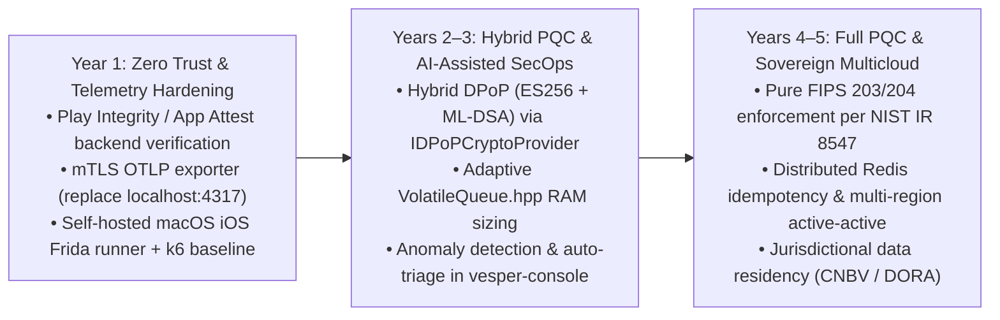

# Emerging Technology Trends, Impact Analysis & 3–5 Year Scalability Roadmap

## Technical Research Memorandum (U8 A3)
**Author:** ChristianPastenC  
**Status:** Prospective Architecture & Phase 2 Roadmap  
**Classification:** DevSecOps / Post-Quantum & AI-Resilient FinTech Engineering  
**Cross-References:** [Cryptographic Specification](../compliance/cryptographic_spec.md) | [NIST CSF 2.0 Gap Analysis](../compliance/gap_analysis_nist_csf.md) | [DORA Operational Resilience](../compliance/dora_operational_resilience.md) | [Results Anticipation & Conclusions (U8 A1)](./results_anticipation_conclusions.md) | [State of the Art & Research](./state_of_the_art.md)

---

## 1. Relevant Emerging Technology Trends

To prevent architectural obsolescence over a 3-to-5-year horizon, **Vesper Platform** must evolve alongside three structural technology shifts directly intersecting its mobile runtime (`@vesper-core/ghost-ledger`), verification microservices (`demo-backend`, `vesper-ingestion`), and deployment topology (`vesper-console`, Render/Netlify). While current verification demonstrates architectural behavior within controlled CI/emulator environments against diagnostic industry baselines (`18.4%–23.8%` drop rates under degraded RF and `~4.7%` duplicate retry collisions documented in [Problem Diagnosis & Operational Baseline](./problem_statement_diagnosis.md)), long-term production viability requires addressing the following shifts:

1. **Post-Quantum Cryptography (PQC) & Cryptographic Agility:**
   - **Standards Baseline:** In August 2024, NIST standardized **FIPS 203 (ML-KEM)** for key encapsulation, **FIPS 204 (ML-DSA)** for lattice-based digital signatures, and **FIPS 205 (SLH-DSA)** for stateless hash-based signatures. In October 2026, **NIST IR 8547** (*Transition to Post-Quantum Cryptography Standards*) formalized deprecation milestones for asymmetric algorithms vulnerable to large-scale quantum computers (Shor's algorithm, affecting **ECDSA, RSA, and EdDSA**)—targeting deprecation after 2030 and disallowance by December 31, 2035—while 256-bit symmetric primitives retain practical resistance.
   - **Repository Coupling:** Currently, [cryptographic_spec.md](../compliance/cryptographic_spec.md), [dpop_auth.go](../../examples/demo-backend/internal/handler/middleware/dpop_auth.go), and [crypto.ts](../../packages/ghost-ledger/src/contracts/crypto.ts) rely exclusively on **ECDSA P-256 (`ES256`)** for JWT and DPoP (RFC 9449) proof-of-possession.

2. **Autonomous AIOps / SecOps & Adversarial Machine Learning:**
   - **Standards & Threat Baseline:** **NIST AI 100-2 E2025** (*Adversarial Machine Learning*, Vassilev et al., 2025) catalogs evasion, data poisoning, and generative/agentic exploitation risks, while enterprise SecOps shifts toward behavioral anomaly correlation and AI-assisted triage over OpenTelemetry streams.
   - **Repository Coupling:** Vesper's current client defense ([DeviceIntegrityGuard.ts](../../examples/demo-mobile/src/core/security/DeviceIntegrityGuard.ts)) and telemetry ingestion ([otel_client.go](../../apps/vesper-ingestion/internal/adapter/telemetry/otel_client.go)) rely on deterministic rules, a fixed 17-byte binary payload, and static export-symbol matching in [frida_dast_test.py](../../examples/demo-mobile/scripts/frida_dast_test.py), with OTLP exported insecurely to `localhost:4317`.

3. **Hardware-Attested Zero Trust & Sovereign Multicloud Resilience:**
   - **Standards Baseline:** **NIST SP 800-207** (*Zero Trust Architecture*, Rose et al., 2020), **DORA (EU 2022/2554)** ICT third-party concentration rules (Art. 28), and Mexican **Ley Fintech / CNBV** data-governance mandates require continuous device-posture verification and jurisdictional data control.
   - **Repository Coupling:** Today, `DeviceIntegrityGuard.ts` evaluates integrity locally on-device without server-verified cryptographic attestation (`Play Integrity` / `Apple App Attest`), and persistence uses single-node embedded stores (`BoltDB` in `demo-backend`, `SQLite` in `vesper-ingestion`) hosted on single-region PaaS targets (Render/Netlify).

---

## 2. Impact Analysis: Risks & Opportunities

| Emerging Trend | Risks to Current Vesper Baseline | Opportunities for Vesper Platform |
| :--- | :--- | :--- |
| **Post-Quantum Cryptography (PQC)** | **1. Harvest Now, Decrypt Later:** Adversaries capturing signed DPoP/JWT traffic or session artifacts today could break ECDSA P-256 keys once CRQCs mature. **2. Payload & RAM Bloat:** ML-DSA signatures and public keys are kilobytes rather than tens of bytes, straining `VolatileQueue.hpp` locked RAM (`mlock`/`VirtualLock`) and degraded cellular links. | **1. Software-Layer Cryptographic Agility:** Extending `IDPoPCryptoProvider` (`packages/ghost-ledger/src/contracts/crypto.ts`) and `DPoPHeader.Alg` (`dpop_auth.go`) enables software-layer hybrid `ES256 + ML-DSA` signing without rewriting business logic, bridging the gap until mobile silicon enclaves add native PQC acceleration. **2. SHA-256 Resilience:** Existing SHA-256 / HMAC-SHA256 ledger chaining (`H_n`) remains viable against Grover's algorithm at 256-bit parameter sizes. |
| **AIOps / SecOps & Adversarial AI** | **1. AI-Generated Polymorphic Frida Scripts:** Automated DBI agents can probe internal `jsi::Runtime` tables and bypass static heuristics in `DeviceIntegrityGuard.ts`. **2. ML Evasion & Telemetry Poisoning:** Naive behavioral models fed by client-originated 17-byte telemetry could suffer poisoning or false-positive lockouts (NIST AI 100-2). | **1. Behavioral Anomaly Detection:** Streaming `OtelClient` metrics (`telemetry_integrity_compromised_total`, latency histograms) into an AIOps pipeline detects coordinated tampering waves. **2. Adaptive CI/CD DAST:** Augmenting `frida_dast_test.py` with adversarial test generation covering native JSI internals and self-hosted iOS runners. |
| **Zero Trust Attestation & Multicloud Sovereignty** | **1. Client-Side Integrity Spoofing:** Without server-verified hardware attestation, rooted/hooked devices can spoof local `DeviceIntegrityStatus` flags. **2. Single-Provider Concentration:** Single-region Render/Netlify hosting and local SQLite/BoltDB files limit horizontal scaling and DORA third-party resilience. | **1. Silicon-Anchored Trust:** Integrating Play Integrity & Apple App Attest token verification into Go auth middlewares before DPoP issuance. **2. Active-Active Sovereign Topology:** Migrating BoltDB/SQLite state to distributed Redis (`SET NX EX 900`) and geo-fenced regional clusters compliant with CNBV and DORA. |

---

## 3. Phase 2 Scalability Roadmap (3–5 Years)

| Horizon | Target Repository Modules | Planned Technical Changes & Integrations |
| :--- | :--- | :--- |
| **Year 1** *(Hardening & Observability)* | `examples/demo-mobile/src/core/security/DeviceIntegrityGuard.ts` `apps/vesper-ingestion/internal/adapter/telemetry/otel_client.go` `.github/workflows/demo-mobile-ci.yml` | Add server-verified remote hardware attestation (Google Play Integrity / Apple App Attest) prior to issuing session tokens; secure OTLP export with mTLS and external collector endpoints; provision a persistent self-hosted macOS runner for iOS DAST and establish `k6` load baselines (`telemetry_stress_test.js`). |
| **Years 2–3** *(Hybrid PQC & Behavioral SecOps)* | `packages/ghost-ledger/src/contracts/crypto.ts` `packages/ghost-ledger/cpp/VolatileQueue.hpp` `examples/demo-backend/internal/handler/middleware/dpop_auth.go` `apps/vesper-console` | Introduce algorithm-agile `IDPoPCryptoProvider` and Go verifier support for hybrid `ECDSA P-256 + ML-DSA` (FIPS 204) / `ML-KEM` (FIPS 203) handshakes; adjust `mlock`/`VirtualLock` buffer budgets and CBOR/binary framing for larger PQC signatures; deploy behavioral anomaly scoring over OpenTelemetry streams with explainable triage views in `vesper-console` hardened against NIST AI 100-2 evasion. |
| **Years 4–5** *(Full PQC & Sovereign Multicloud)* | `examples/demo-backend` (`internal/store`) `apps/vesper-ingestion` (`internal/adapter/db`) Cloud & Infrastructure Topology | Replace embedded single-node BoltDB/SQLite state with distributed Redis (`SET NX EX 900`) and replicated relational/timeseries storage across multi-cloud active-active regions; deprecate standalone classical ECDSA per NIST IR 8547 milestones; enforce tenant-level jurisdictional data residency aligned with CNBV and DORA Art. 28 exit/portability mandates. |

---

## 4. References

1. European Parliament and Council of the European Union. (2022). *Regulation (EU) 2022/2554 on digital operational resilience for the financial sector (DORA)*. Official Journal of the European Union, L 333, 1–79.
2. Fett, D., Campbell, B., Bradley, J., Lodderstedt, T., Jones, M., & Waite, D. (2023). *OAuth 2.0 Demonstrating Proof-of-Possession (DPoP)* (RFC 9449). Internet Engineering Task Force (IETF). https://doi.org/10.17487/RFC9449
3. H. Congreso de la Unión. (2018). *Ley para Regular las Instituciones de Tecnología Financiera (Ley Fintech)*. Diario Oficial de la Federación.
4. Kissel, R., Regenscheid, A., Scholl, M., & Stine, K. (2014). *Guidelines for media sanitization* (NIST Special Publication 800-88 Rev. 1). National Institute of Standards and Technology. https://doi.org/10.6028/NIST.SP.800-88r1
5. Moody, D., Perlner, R., Regenscheid, A., Robinson, A., & Cooper, D. (2026). *Transition to Post-Quantum Cryptography Standards* (NIST Interagency or Internal Report 8547). National Institute of Standards and Technology.
6. National Institute of Standards and Technology. (2024). *Module-Lattice-Based Key-Encapsulation Mechanism Standard* (FIPS PUB 203), *Module-Lattice-Based Digital Signature Standard* (FIPS PUB 204), & *Stateless Hash-Based Digital Signature Standard* (FIPS PUB 205). U.S. Department of Commerce.
7. Payment Card Industry Security Standards Council. (2022). *Payment Card Industry (PCI) Data Security Standard: Requirements and Testing Procedures v4.0*. PCI SSC.
8. Rose, S., Borchert, O., Mitchell, S., & Connelly, S. (2020). *Zero Trust Architecture* (NIST Special Publication 800-207). National Institute of Standards and Technology.
9. Vassilev, A., Oprea, A., Fordyce, A., Anderson, H., Davies, X., & Hamin, M. (2025). *Adversarial Machine Learning: A Taxonomy and Terminology of Attacks and Mitigations* (NIST AI 100-2 E2025). National Institute of Standards and Technology.
