# Contextual Diagnosis, Causal Evaluation & Quantitative Problem Definition

## 1. Organizational and Operational Context

The Vesper Core Platform operates within the architectural perimeter of mobile payment acquiring and financial technology (PayTech/Fintech) across Latin America. The technical infrastructure powers mobile Point-of-Sale (mPOS) terminals via native SDK libraries (`@vesper-core/ghost-ledger`) running on commercial Android and iOS devices.

Operational deployments face severe radio-frequency (RF) degradation across four strategic commercial verticals:
1. **Last-Mile Logistics & Distribution:** Field collections in urban peripheries, highway tunnels, and reinforced concrete basements with cellular carrier fading.
2. **Mass Events & Sports Stadiums:** Transport-layer TLS packet loss exceeding 35% caused by severe RF spectrum saturation.
3. **Line-Busting Mobile Retail:** Micro-outages occurring during active network handovers between enterprise Wi-Fi access points and cellular (4G/5G) towers.
4. **Interurban & Public Transit:** High-speed travel through dead zones without terrestrial cell towers or repeater coverage.

Under strict regulatory oversight from banking authorities (CNBV Circular Única de Bancos, Ley Fintech, and PCI-DSS v4.0), transaction processing involves Primary Account Numbers (PAN) and Sensitive Authentication Data (SAD: PIN blocks, EMV cryptograms), whose retention on secondary storage media is strictly prohibited.

---

## 2. Empirical Investigation ($N = 24$) and Diagnostic Triangulation

To ground architectural decisions in reproducible empirical data, a mixed diagnostic instrument (survey and deep technical interviews) was conducted across a qualified sample of $N = 24$ industry specialists:
* 6 Mobile Software Engineers
* 5 Transactional Backend Architects
* 4 Qualified Security Assessors (QSA) & Compliance Officers
* 4 Business Continuity (BCP/DRP) Specialists
* 5 Field Operations Supervisors

### 2.1. Consolidated Findings Matrix

| ID | Variable / Indicator | Dimension | Consolidated Empirical Finding | Architectural Impact on Vesper |
| :--- | :--- | :--- | :--- | :--- |
| **R1** | Transactional rejection rate due to network drops | Continuity | **21.2% mean drop rate** (18.4% in logistics, 23.8% peak in mass events). | Justifies offline-first deferred ingestion engine. |
| **R2** | Duration of temporary cellular dropouts | Telecom | **94.6% of outages last $< 7\text{ min}$**; $P_{99}$ is $13\text{ min}$ ($\le 15\text{ min}$ MTPD). | Establishes the 900s ($15\text{ min}$) volatile containment window. |
| **R3** | Incidence of duplicate charges upon reconnection | Integrity | **4.7% transaction collisions** provoked by uncoordinated retries. | Requires server-side atomic Redis idempotency locks. |
| **R4** | Legal & regulatory risk of using SQLite/Flash (1–5) | Compliance | **Mean 4.92 / 5.00** (100% of legal/QSA officers issue absolute veto). | Dictates strict Zero-Disk memory retention policy. |
| **R5** | Time lost per failed transaction | Operations | **78 seconds of friction**, triggering merchant and customer churn. | Requires sub-100ms transparent local trapping. |
| **R6** | Managed runtime memory limitations (React Native) | Architecture | Immutable JavaScript strings prevent in-place memory wiping. | Requires native C++20 JSI bridge outside GC. |
| **R7** | Forensic objection to physical NAND Flash storage | QSA Audit | **Wear Leveling algorithms preserve stale blocks** upon SQLite deletion. | Mandates volatile DRAM with `mlock` page locking. |
| **R8** | Requirement for duplicate-free deferred settlement | Backend Go | Asymmetric DPoP session tokens (RFC 9449) and atomic Redis locks. | Establishes `SET NX EX 900` idempotency middleware. |

---

## 3. Ishikawa Causal Analysis

```mermaid
graph LR
    subgraph Telecom [1. Network & Telecom]
        T1["RF Shadows in Basements & Tunnels"]
        T2["Wi-Fi / Cellular Handover Disconnects"]
        T3["Rigid 5s Sync Timeouts"]
    end

    subgraph Mobile [2. Mobile Architecture]
        M1["JS String Immutability in Heap"]
        M2["Non-Deterministic Garbage Collection"]
        M3["Software-Only Cryptographic Keys"]
    end

    subgraph Regulatory [3. Regulatory Boundaries]
        R1["PCI-DSS v4.0 Req. 3.2 (Zero SAD in Flash)"]
        R2["NAND Wear Leveling Remanence"]
        R3["CNBV Sanctions (Up to 320,000 UMAs)"]
    end

    subgraph Operations [4. Field Operations]
        O1["Blind Retries Causing Double Charges"]
        O2["78s Checkout Friction per Failure"]
        O3["Customer Abandonment at POS"]
    end

    Problem["TRANSACTIONAL PARALYSIS<br>(18.4%-23.8% DROP RATE)<br>& INVIABILITY OF DISK STORAGE"]

    Telecom --> Problem
    Mobile --> Problem
    Regulatory --> Problem
    Operations --> Problem

    style Problem fill:#7f1d1d,stroke:#ef4444,stroke-width:2px;
    style Telecom fill:#1e1b4b,stroke:#6366f1,stroke-width:1px;
    style Mobile fill:#1e1b4b,stroke:#6366f1,stroke-width:1px;
    style Regulatory fill:#1e1b4b,stroke:#6366f1,stroke-width:1px;
    style Operations fill:#1e1b4b,stroke:#6366f1,stroke-width:1px;
```

---

## 4. Quantitative Financial Impact Assessment

For a representative mid-tier acquiring operation processing **150,000 daily transactions** with an average ticket of **\$450.00 MXN**, where 25% of operations occur under intermittent connectivity:

* **Direct Transactional Abandonment (TAR):** An average drop rate of 21.2% represents **7,950 aborted transactions per day** (\$3,577,500.00 MXN in uncollected daily gross transaction volume). At a standard 2.1% Merchant Discount Rate (MDR) fee, the payment facilitator incurs a permanent loss of **\$2.25 million MXN monthly** in net revenues.
* **Dispute and Chargeback Overhead:** The 4.7% collision rate generates thousands of disputed transactions before regulatory bodies (CONDUSEF). With administrative arbitration costs between \$250 and \$450 MXN per dispute, double charges accelerate merchant attrition (*churn*).
* **Regulatory Revocation Risk:** Persisting cardholder data on Flash storage risks immediate decertification under PCI-DSS and fines up to **320,000 UMAs (\$34.7 million MXN)** under Mexican Fintech Law and CNBV regulations.

---

## 5. Formal Problem Statement

> **Core Problem Statement:**  
> Operational paralysis and transactional abandonment affecting between 18.4% and 23.8% of mPOS transactions caused by wireless network instability in mobile field environments, compounded by regulatory prohibitions against secondary non-volatile persistence (Flash NAND/SQLite) under PCI-DSS v4.0 Req. 3.2, and by the inability of managed JavaScript runtimes to enforce deterministic cryptographic zeroization in RAM and atomic idempotency upon reconnection.

---

## 6. Vesper Solution Mapping Matrix

| Diagnostic Cause | Operational Manifestation | Vesper Engineered Countermeasure |
| :--- | :--- | :--- |
| **Radio Intermittency** | TLS socket disconnects in commercial field routes ($P_{99} = 13\text{ min}$). | **Volatile Ring Buffer:** $\text{TTL} = 900\text{ s}$ ($\text{MTPD}$), $\text{RPO} = 0\text{ s}$, $\text{RTO} < 100\text{ ms}$. |
| **Heap Memory Scraping** | Plaintext card data retained in managed JavaScript heap. | **Native C++20 Core (`ghost-ledger`):** `memset_s` active zeroization & `mlock` page locking. |
| **PCI-DSS Flash Prohibition** | Wear leveling leaves plaintext blocks upon SQLite file deletion. | **Hardware Enclave (StrongBox / Secure Enclave):** Ephemeral AES-256-GCM without secondary storage I/O. |
| **Field Reattempt Collisions** | Manual retries causing 4.7% duplicate charges. | **Go Ingestion (`vesper-ingestion`):** Asymmetric DPoP (RFC 9449) and atomic Redis `SET NX EX 900` locks. |
