# Theoretical Foundations: Low-Level Cryptography, Resilient Runtimes & Regulatory Compliance

## 1. Overview and Epistemic Architecture

The engineering of resilient mobile transactional architectures requires an interdisciplinary framework bridging low-level operating system internals, applied cryptography, distributed consensus, and international regulatory mandates.

This document formalizes the four theoretical pillars governing the Vesper Core Platform:
1. **Contextual Framework:** Mobile commerce execution boundaries and runtime vulnerabilities.
2. **Referential Framework:** Critical benchmarking of commercial and academic persistence models.
3. **Conceptual Framework:** Applied cryptographic primitives, memory sanitization, and continuity metrics.
4. **Ethical & Legal Framework:** Fiduciary duties, financial regulation, and compliance standards.

---

## 2. Contextual & Referential Benchmarking

Modern hybrid mobile environments (React Native, Flutter) optimize multi-platform development but introduce structural security vulnerabilities:
* **Heap Scraping:** Managed runtimes (Hermes, V8) utilize garbage collection cycles that leave sensitive credit card objects accessible in memory for indeterminate periods, susceptible to runtime instrumentation (Frida, Xposed - Sutter et al., 2024).
* **The "False Choice" in Industry:**
  * *Fail-Closed Abortive Model (Stripe Terminal):* Immediately cancels in-flight transactions upon any cellular socket disconnect, shifting the cost of network instability ($5,600 USD/min downtime) to the merchant and violating DORA resilience mandates.
  * *Secondary Flash Store-and-Forward (Square, Clover):* Persists unsubmitted cardholder data to local NAND Flash storage, directly violating **PCI-DSS v4.0 Requirement 3.2**.

```text
+------------------------------------------------------------------------------------------+
|                       COMPARATIVE INDUSTRY TAXONOMY                                      |
+-------------------+----------------+--------------------+---------------+----------------+
| Solution          | Model          | Data Storage       | Heap Exposure | PCI-DSS v4.0   |
+-------------------+----------------+--------------------+---------------+----------------+
| Stripe Terminal   | Fail-Closed    | None (Aborts)      | Non-Applicable| Compliant      |
| Square / Clover   | Store & Forward| NAND Flash (Disk)  | High (NAND)   | Non-Compliant  |
| Realm / SQLite    | Reactive Sync  | Local Database     | High (Heap)   | Non-Compliant  |
| Vesper Platform   | Fail-Safe RAM  | Volatile C++ DRAM  | Immune (Zero) | Fully Aligned  |
+-------------------+----------------+--------------------+---------------+----------------+
```

---

## 3. Core Conceptual Pillars

```mermaid
graph TD
    subgraph ClientMobile ["Mobile Client Boundary (@vesper-core/ghost-ledger)"]
        UI["React Native UI Layer"] -->|Direct JSI Shared Pointer| Bridge["Nitro Modules C++20"]
        Bridge -->|Lock Pages: mlock / VirtualLock| RingBuffer["Volatile RAM Ring Buffer"]
        RingBuffer -->|C11 memset_s & DSE Barrier| Wiped["Active Zeroization (NIST SP 800-88)"]
        Enclave["Hardware Silicon Enclave<br>(StrongBox / Secure Enclave)"] -.->|AES-256-GCM Ephemeral Keys| RingBuffer
    end

    subgraph Transport ["Encrypted Transport Perimeter"]
        RingBuffer -->|DPoP Proof RFC 9449| Dispatch["TLS 1.3 Transport"]
    end

    subgraph BackendCluster ["Cloud Gateway Boundary (Go Backend)"]
        Dispatch --> Gateway["vesper-ingestion / demo-backend"]
        Gateway -->|Atomic Lock SET NX EX 900| RedisCluster["Distributed Redis Cache"]
        Gateway --> Ledger["Core Settlement Database"]
    end

    style ClientMobile fill:#0f172a,stroke:#3b82f6,stroke-width:2px;
    style BackendCluster fill:#1e1b4b,stroke:#6366f1,stroke-width:2px;
```



### 3.1. Zero-Disk Footprint & Physical Page Locking (`mlock`)
To guarantee zero exposure under forensic analysis, no transactional data ever touches secondary storage. Furthermore, pages allocated within native C++ DRAM are locked using `mlock(2)` (Linux/Android/iOS) or `VirtualLock` (Windows) to prevent kernel virtual memory subsystems from paging buffers into swap or compressed zRAM.

### 3.2. Active Byte-Level Zeroization (Philippe et al., 2023)
Standard memory deallocations and compiler optimizations (`-O2`, `-O3`) legally discard conventional `memset()` calls via Dead Store Elimination (DSE) if the buffer is destroyed immediately after. Vesper mitigates DSE by enforcing:
1. Standard C11 `memset_s(3)` (Annex K).
2. Inline assembly memory barriers: `__asm__ __volatile__("" : : "r"(ptr) : "memory");`.
3. Volatile-pointer iteration fallback ensuring physical overwrite with `0x00`.

### 3.3. Hardware Root of Trust (HRoT - Blessing et al., 2021)
All cryptographic keys encrypting volatile memory segments are requested directly from dedicated hardware security modules:
* **Android:** StrongBox Keymaster (`setIsStrongBoxBacked(true)`).
* **iOS:** Apple Secure Enclave (`kSecAttrAccessControl`).
* **Fail-Closed Policy:** If hardware-backed silicon is absent, or if root/jailbreak is detected, deferred processing is halted.

### 3.4. Cryptographic Idempotency & DPoP (RFC 9449 / Wang et al., 2023)
Network reconnections produce out-of-order retransmissions. Vesper mitigates duplicate charges through:
* **DPoP Signatures:** Asymmetric ECDSA ES256 proofs linking requests to the device's hardware key, incorporating server-driven challenge nonces (`DPoP-Nonce`).
* **Atomic Redis Locks:** The backend ingests transaction payloads using atomic `SET NX EX 900` operations matching the 900s client MTPD window, ensuring duplicate requests receive cached responses without re-executing debits.

---

## 4. Continuity Metrics & Regulatory Traceability

Under **ISO 22301:2019** and the **Digital Operational Resilience Act (DORA)**, Vesper establishes quantitative resilience boundaries:
* **Recovery Point Objective (RPO = 0 s):** In-flight requests interrupted by transport disconnects are captured atomically into volatile RAM before socket teardown.
* **Recovery Time Objective (RTO < 100 ms):** Direct memory transition into C++ Nitro buffers occurs imperceptibly without blocking UI threads.
* **Maximum Tolerable Period of Disruption (MTPD = 15 min / 900 s):** Calibrated to cover 99% of commercial cellular outages ($P_{99} = 13\text{ min}$). Upon timer expiration, memory buffers are actively wiped (`Active Zeroization`), converting prolonged outages into secure timeouts.

### Regulatory Compliance Mapping

| Regulatory Standard | Mandate Description | Vesper Compliance Mechanism |
| :--- | :--- | :--- |
| **DORA (EU 2022/2554, Arts. 6–12)** | Operational continuity in critical financial payment channels. | Volatile C++ RAM sequestration ($\text{RPO} = 0\text{ s}$, $\text{RTO} < 100\text{ ms}$). |
| **PCI-DSS v4.0 (Req. 3.2)** | Absolute prohibition of SAD retention post-authorization. | Zero-Disk policy; Flash I/O blocked; physical wiping via `memset_s`. |
| **PCI-DSS v4.0 (Req. 3.4)** | Cryptographic protection of cardholder account numbers (PAN). | In-memory AES-256-GCM encryption anchored to hardware enclaves. |
| **CNBV Circular Única de Bancos** | Integrity and non-repudiation in mobile banking and mPOS terminals. | Hash-chained transaction blocks ($H_n$) and asymmetric DPoP proofs. |
| **Ley Fintech (México, Arts. 54 & 56)** | Technological contingency plans and automated deduplication controls. | Redis atomic `SET NX EX 900` idempotency locks eliminating 100% of double charges. |
